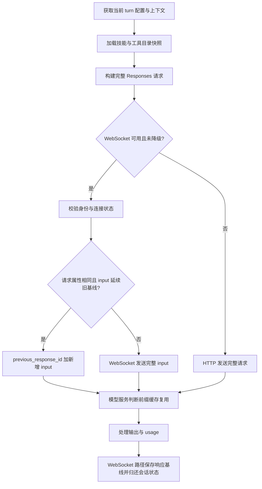

# 缓存实现逻辑与代码路径

适用范围与核验状态同[主题正文](README.md)：`rust-v0.171.0`，固定提交 `ccf9be8cc458bd6b8336fe84d68d8893f2691a5e`，2026-11-23 静态核验。下列伪代码只解释控制流，不是可直接替换的 Rust 实现。证据编号指向[来源页](来源与适用边界.md)。

## 1. 请求链路



Prompt Cache 与传输增量是独立判断。图中的目录发现也不是“每步必定发网络请求”，其内部先执行各自复用策略。

## 2. Prompt cache key 与 TTL

S1、S2、S3 对应：`core/src/thread_manager.rs` 的 `PromptCacheKey`，`core/src/client.rs` 的 `prompt_cache_key`、`session_derived_cache_key` 和请求组装，`protocol/src/turn_input.rs` 的 `PromptCacheTtl`。

```text
policy = SessionDerived:
    若有 session_id_override，返回 override
    否则若属于 Internal(source) 且有 parent_thread_id，返回 source:parent_thread_id
    否则返回 metadata.session_id
policy = Custom(value): 返回 value
policy = Omit: 不发送此字段

prompt.prompt_cache_ttl 有值:
    request.prompt_cache_options = { ttl: "30m" 或 "12h" }
否则省略 prompt_cache_options
```

冷恢复时宿主需重新施加缓存键策略，不能假设持久化历史会自动恢复 Custom 策略。代码构造请求时设置 `store: false`，同时仍发送缓存字段；由此可以确认客户端没有把 store 当作 Prompt Cache 开关。后端的存储和数据保留政策需查对应产品约定。

## 3. WebSocket continuation

S1 的 `WebsocketSession` 保存 `last_request` 与 `last_response_rx`；`ModelClientSession::drop` 将状态放回 session client。

```text
last_response = 从上一响应通道取已完成结果
若没有上一请求／响应／有效 response_id：full
若请求属性不匹配：full
baseline = previous_request.input + last_response.items_added
逐项比较 baseline 与 current_request.input 的前缀
若当前 input 更短或任一项不匹配：full
否则：incremental，发送 previous_response_id + current_input 剩余项
```

`responses_request_properties_mismatch` 对以下字段逐项比较：model、tools、tool_choice、parallel_tool_calls、reasoning、store、stream、include、service_tier、prompt_cache_key、prompt_cache_options、text。input 单独比较；stream_options、client_metadata、access_programs、request_country 有各自的逐响应处理语义，不简单按整个请求做 PartialEq。

input 项由 `response_items_equal_ignoring_internal_metadata` 比较：内部消息元数据可清除后比较；工具结果元数据不同仍判为不匹配。迟到工具结果修改了旧项时，不能只发送一个增量后缀代表该变更。

复用失败的有界原因标签包括 `no_previous_request`、`no_previous_response`、`no_previous_response_id`、`model_changed`、`tools_changed`、`prompt_cache_key_changed`、`prompt_cache_options_changed`、`input_shortened`、`input_mismatch` 等。恢复历史且没有可用基线的路径标注 `restored_history`；连接重建还可带 `connection_closed` 或 `other`。这些是客户端续传诊断原因，不能直接充当模型缓存 miss 原因。

## 4. 模型目录缓存

S4 的 `OpenAiModelsManager::load_catalog` 在 refresh lock 下按策略决策；还需先通过 provider／discovery 能力约束。

```text
InMemory: 使用内存状态，不读缓存、不联网
Offline: 尝试缓存，不发起发现请求
OnlineIfUncached / 初始化:
    若可用缓存被接受：完成
    否则请求 endpoint 并更新
Online: 在允许发现的路径直接请求 endpoint
```

文件缓存 `load_fresh_file` 验证版本及 TTL；manager 验证 endpoint identity、版本与 `MIN_UTC` 作废标记。读取异常作为未获得可用缓存处理；在线策略可继续请求端点，Offline 仍不联网。成功发现写入 `fetched_at`、etag、client_version、identity、models。内存当前目录不等于每次使用都重新执行文件 TTL 检查。

`refresh_if_new_etag`：ETag 不同时走在线刷新；相同时尝试 `refresh_ttl`。内置文件后端仅在版本、identity、etag 一致，且不再处于半个 TTL 的新鲜区间时更新 fetched_at。provider 目录遭 access／credentials rejection 时，用作废时间标记防止随后加载旧目录掩盖拒绝。

## 5. Host Skills 快照

S5 的 `HostSkillsService::snapshot_for_skill_roots`：

```text
根据 effective roots / 规则 / 插件快照等建立 ConfigSkillsCacheKey
从队列取出同 key 旧条目
若 force_reload：丢弃旧 cell；否则复用 cell
把条目放队首，截断到 32 项
cell.get_or_init(扫描、解析并合并 roots)
返回不可变快照的 clone
```

`OnceCell` 合并同配置的首次加载；根扫描共享 semaphore 控制并发，request-local root snapshots 合并一次请求内部的重复扫描。cwd 快速缓存只在特定 repository 条件和无 effective plugin roots 等条件下使用，不能把 cwd 描述成唯一键。

`set_extra_roots` 会清缓存；`clear_cache` 清理 cwd、config 等发现状态。app-server watcher 对已注册路径触发同一主动失效，并通知前端。watcher 是 app-server 路径，不应自动推广为每个独立 CLI 宿主都有同样机制。

内置系统 Skills 安装独立走 marker 指纹校验；这是安装产物复用，并不是缓存用户修改过的全部技能正文。

## 6. Cloud／Executor Skills

S6 的 `SkillCatalogState` 以 `CloudSkillGeneration` 绑定认证和资源状态。目录刷新在异步请求前捕获 generation，完成后重新检查认证、resource cache key 和 Arc identity；已被替代的刷新不能发布。接受的目录包括 partial 结果也会建立新 generation 并清空正文缓存；partial、warning 或失败按退避规则再尝试。

Cloud 正文缓存 `SkillReadCacheKey = authority + package + resource`。成功读取后复核认证与 generation；返回资源不符则不入缓存。满 100 项或加入后总正文超过 8 MiB 时直接返回结果而不新增缓存，它不是“满了就淘汰最旧项”的 LRU。

Executor Skills 有 turn／roots／访问键缓存，以及 Discovery V1／V2 快照投影复用。底层 S9 的 `ExecutorCapabilityDiscoveryCache` 按 executor session、环境实例、root、sandbox 复用发现结果，暂时故障重试，恢复后报告给下游，避免把短暂错误永久冻结为“没有能力”。

## 7. MCP 工具目录

S7 的 `McpToolCatalogCache::context` 首先建立可复用 identity，不能可靠表达的凭据或传输上下文返回 None。identity 命中 LRU 后取得共享 entry。

```text
读取：检查 disabled、revision／discovery 资格、TTL，以及当前视图是否接受工具
未命中：建立 fetch ticket，分配递增 generation
完成：仅当未 disabled 且 ticket.generation 更新时发布
发布：清除 tool annotations，写入目录、meta、published_at、revision
```

工具列表变化跟踪使用可变化的 revision 令旧目录不可复用；enable tracking 不能复用原先没有跟踪 revision 的目录。modern stdio discovery 也可排除较旧 legacy 目录。`current_catalog_or` 可保留当前 capture 的 fallback 跨过 TTL，但不能绕过 disabled 或 revision 校验。

实际工具调用由连接绑定与实时授权决定。目录命中没有省略调用或批准工具副作用；相关测试验证跨线程工具调用仍绑定各自线程。

## 8. 插件解析与审批决定

S8 的 `ManifestCache::load` 仍读取 manifest／overlay；`parse` 以 root＋path 找旧条目，再比较 SHA-256。相同内容返回解析对象；变化重新解析。成功项进入最多 128 项 LRU；超过 64 KiB 的输入移除旧项并走不缓存解析。解析失败不保存成功条目，之后可重试。

S10 的 `with_cached_approval`：空键集正常发起审批；只有所有键都命中 `ApprovedForSession` 才跳过询问。新决定仅为 `ApprovedForSession` 时写入各键。各工具的 key 构造规则独立，不可把一次批准推广为所有操作。

[返回主题](README.md) · [来源与适用边界](来源与适用边界.md)
