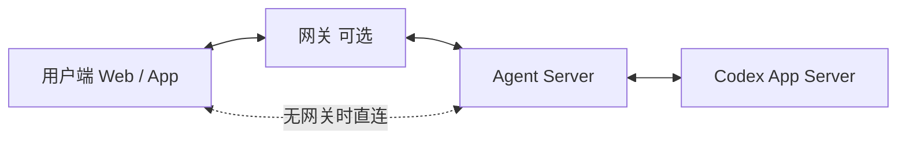

# ADR-0001：采用 Codex App Server 作为执行引擎

> 本决策随旧方案废弃，保留作历史记录。后续架构以重新设计为准。

- 状态：已废弃。
- 决策日期：2026-11-23。
- 决策依据：项目负责人明确采用 Codex App Server，并确定“用户端（Web/App）→ 可选网关 → Agent Server → Codex Server”的链路。
- 实施状态：架构路线已确定，服务接入与运行闭环尚未实现。

> 当前实施方案统一在 [codex-server-complete-plan.md 的方案总览](../../codex-server-complete-plan.md#方案总览)维护；本记录用于追溯已接受的选型。后续职责和实施顺序调整同步至主方案。

## 目标与决策

本项目以 Codex App Server 承担 Codex 会话和 Agent 执行能力，外层 Agent Server 提供面向自有客户端的接入、会话映射、工作区管理和事件交互。

这项决策确定执行引擎选型。下列职责划分、MVP 范围和实施顺序是据此制定的推进基线；部署位置、开发语言、认证方式和最终运行版本仍需在实施时落实，不因本记录而视为已经选定。

## 已确定的访问链路

请求沿链路下发，响应、事件和审批请求沿链路返回；审批决定由用户端经同一链路提交。本文的 Codex Server 指 Codex App Server。

网关启用时作为独立接入层；省略时用户端直接连接 Agent Server。Agent Server 是自有业务与会话管理层，Codex Adapter 是其内部模块。是否使用网关不改变 Agent Server 对会话归属、工作区和访问权限的管理责任。

## 职责边界

| 组件 | 本项目中的职责 |
|---|---|
| 用户端（Web/App） | 发起任务、展示响应与工具事件、提交审批决定、查看结果 |
| 网关（可选） | 统一接入、身份校验、路由、限流与连接代理；向 Agent Server 传递经过验证的身份上下文 |
| Agent Server | 客户端访问控制、Session 与 thread ID 映射、Workspace 绑定、请求关联、事件转发和状态恢复 |
| Codex Adapter | 封装 App Server 协议、请求与通知分流、服务端请求应答、错误与生命周期处理 |
| Codex App Server | 提供所接入版本支持的会话、模型调用、工具执行及审批交互能力 |
| Workspace | 保存项目文件、Git 工作区和验证产物；与会话绑定并按运行边界隔离 |

首版建议采用单个 Agent Server 服务，优先验证本机或同主机上的 App Server 接入。网关按部署需要选用；使用时需支持持续事件转发和审批往返。Agent Server 根据有效身份校验业务权限，App Server 的具体传输与部署配置在接入验证时确定。

## 最小实施闭环

1. **协议基线**：选择并固定实际运行的 Codex 版本，核对其初始化、thread／turn、事件、审批和错误协议，形成可运行的连接探针。
2. **单会话执行**：绑定一个测试 Workspace，创建会话、发起 turn，接收文本和工具事件，正确识别完成、失败和取消。
3. **双向交互**：处理 App Server 发起的审批请求与其他需要客户端应答的请求；关联 request ID 并正确回传用户决定。
4. **持续会话**：保存自有 Session 与 Codex thread 的映射，验证客户端断线重连及服务进程重启后的恢复；分别处理传输连接、加载中的线程和持久化历史。
5. **代码任务验收**：在测试仓库完成一次修改、diff 查看与测试执行，保留结果和验证记录。
6. **能力扩展**：在基础闭环稳定后接入 Skill／MCP 选择、并发策略和有证据支撑的缓存优化。

优先交付物是“协议探针＋单会话完整往返＋测试记录”。动态 Skill Registry、独立 Gateway、Redis、分布式 Worker 和多租户调度待实际需求出现后分别设计。

## 验收条件

- 请求、响应、通知和服务端请求均能正确关联；失败时可定位原始错误。
- 同一 Session 的后续消息继续对应的 Codex thread，Workspace 绑定不串线。
- 用户端直连 Agent Server 时完成基本闭环；启用网关时，同样验证事件转发、审批往返和断线恢复，保持身份及会话关联。
- 在只读与代码修改任务中，文本、工具状态、审批及终止状态均有完整交互。
- 客户端重连与 App Server 重启分别验证；恢复会话不被误记为恢复了内存连接或模型缓存。
- 无法恢复、审批取消、执行中断及连接失败有明确的用户可见状态。
- 已修改文件、diff 与测试结果可回查；测试失败不会被标记为任务验证通过。

以上是待完成的验收条件，不是已经通过的运行记录。

## 版本与缓存约束

知识库当前缓存研究以 `rust-v0.171.0` 的固定提交为基线。它是研究版本，不自动指定生产运行版本；接入探针需记录实际二进制版本和协议来源。

常驻 App Server 可保留其生命周期范围内的内存状态，但线程恢复、连接复用、目录缓存和模型端 Prompt Cache 各自受不同条件约束。缓存策略遵循已核对的[机制说明](../../codex/架构/运行机制/缓存策略与实现/README.md)，观测遵循[缓存诊断](../../codex/运维/监控与诊断/缓存诊断/README.md)。

## 相关材料与效力

- [实施方案与历史讨论](../../codex-server-complete-plan.md)：方案总览是当前实施依据；历史接口、认证、套餐与示例仍需按实施版本核验。
- [Codex 知识库](../../codex/README.md)：通用机制、来源与版本边界。
- 本记录：本项目已接受的执行引擎选型及后续推进基线；不作为 Codex 通用产品事实引用。
